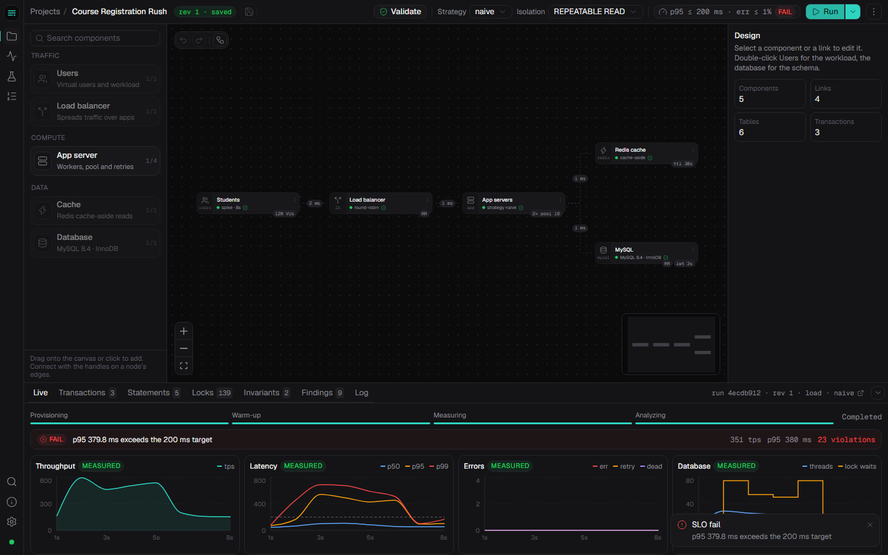
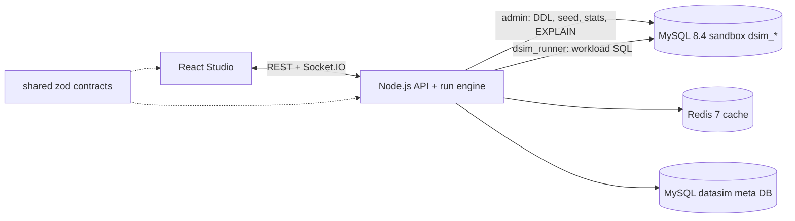

# DataSim

**DataSim is Cisco Packet Tracer for database engineers.** Drag components onto a canvas (users, load balancer, app servers, cache, database), design the schema visually, describe the workload as real parameterized SQL transactions, and run it against a **real MySQL 8.4 / InnoDB server**. DataSim shows latency, throughput, contention, anomalies and where the design breaks, before you build the real system.



It answers five questions with evidence rather than opinion:

1. Will this schema and topology handle N concurrent users, and at what load does it break? (capacity test, SLO verdict, Universal Scalability Law projection)
2. What latency does each transaction see (p50 / p95 / p99), and where is the time spent? (app queue, network, connection-pool wait, DB execution)
3. Is the data still correct under concurrency? (SQL invariants: lost update, overbooking, deadlocks)
4. What changes if I add an index, a cache, more app servers, a bigger pool, a different isolation level or a different concurrency-control strategy? (fork the design, re-run, compare)
5. Which statements are slow and why? (`performance_schema` digests + `EXPLAIN` + a rule-based advisor)

## Quick start

Prerequisites: Node.js 20+, Docker Desktop (running).

```bash
npm ci
npm run demo      # .env -> docker (MySQL 8.4 + Redis 7) -> migrations -> templates -> API + web
```

Open **http://localhost:5173/DataSim/**, pick a template (start with *Course Registration Rush*) and press **Run**. `npm run doctor` checks Docker, ports, MySQL version, `performance_schema`, Redis and the restricted runner user. The 6-8 minute demo script is in [docs/DEMO.md](docs/DEMO.md); `npm run demo:prime` pre-runs it so the reports already exist as a fallback.

## Features

* **Studio:** canvas with connection rules enforced while dragging, inspector forms, undo/redo, autosaved drafts and immutable revisions, strategy / isolation quick selectors, live charts and animated request flow during runs, bottleneck highlighting.
* **Real tables:** the schema model becomes real DDL (PK, FK, UNIQUE, INDEX, CHECK, generated columns), seeded deterministically (seeded PRNG, zipf / normal / pattern / fkRef generators).
* **Schema Designer:** ER canvas, table editor, DDL preview, seed settings, import from `CREATE TABLE`, normalization assistant (closure, candidate keys, normal form, BCNF decomposition, 3NF synthesis).
* **Workload Editor:** transaction mix, parameter generators, strategy variants (naive / pessimistic / optimistic / atomic / serializable), SQL steps with bind / guard / expect-affected, *Test once* in a rolled-back transaction, invariants.
* **Run reports:** KPIs with provenance tags, where-the-time-went, per-transaction and per-statement stats, lock waits with a wait-for graph, invariants, advisor findings with one-click fixes (apply, re-run, compare).
* **Capacity test:** stepped load, knee detection, USL fit with the projected curve dashed, Little's-law check.
* **Compare:** side-by-side metrics with direction-aware deltas, overlaid charts, design diff between revisions.
* **Concurrency Lab** and **Transaction Stepper** (from Review 1): eight strategies benchmarked on real InnoDB, and two transactions stepped statement by statement with the live lock table.
* **Templates:** Course Registration Rush, Review 1 Shared Resource Allocation, Flash Sale Checkout, Bank Transfers and Deadlocks.
* Local and offline: no external APIs, bundled fonts, works with Docker Desktop on Windows, macOS and Linux.

## Measurement model: MEASURED / EMULATED / PROJECTED

Every number carries a provenance tag.

| Tag | Meaning |
| --- | --- |
| **MEASURED** | Observed from MySQL or the real request path: DB execution time, lock waits, deadlocks, rows examined, invariants, end-to-end latency, cache hit ratio |
| **EMULATED** | An injected delay or modelled component that really runs in the request path: link latency, app processing time, load balancer. They are real awaits, so they hold users and create real queueing |
| **PROJECTED** | A model fitted to measured data: capacity beyond the tested load (USL fit) |

## Architecture



Details: [docs/ARCHITECTURE.md](docs/ARCHITECTURE.md). Meta schema and normalization argument: [docs/DATABASE_DESIGN.md](docs/DATABASE_DESIGN.md). Review 1 mapping: [docs/REVIEW1_TRACEABILITY.md](docs/REVIEW1_TRACEABILITY.md). Viva preparation: [docs/VIVA.md](docs/VIVA.md).

## Tech stack

Node.js, TypeScript, Express, Socket.IO, `mysql2`, `ioredis`, zod (server); React, Vite, Tailwind CSS v4, React Flow, zustand + zundo, recharts, CodeMirror, Radix primitives (web); MySQL 8.4 / InnoDB, Redis 7 (Docker); vitest, supertest, Playwright (tests). The PRNG, data generators, USL fit and normalization algorithms are hand-written.

## Project structure

```
shared/   zod schemas + types shared by server and web (design, schema, workload, run report, DDL, PRNG, USL, normalization)
server/   Express API, run engine (src/engine), projects + templates, Concurrency Lab, Transaction Stepper, tests
web/      React app (src/features: studio, schema, workload, report, compare, lab, stepper, tier2)
db/       Docker init SQL and migrations (005 = v2 meta schema)
e2e/      Playwright flows
scripts/  demo, doctor, demo:prime, bench
docs/     architecture, database design, demo script, viva, Review 1 traceability, archive/
```

## Tests

```bash
npm run typecheck
npm test            # shared + server (real MySQL in Docker) + web unit tests
npm -w web run build
npm run e2e         # Playwright, headless Chromium (npm run e2e:install once)
```

## Credits

Akshat Raj (24BCE0043), Vishal Vivek (24BCE2377), Mohit Kumar (24BCE2378).
