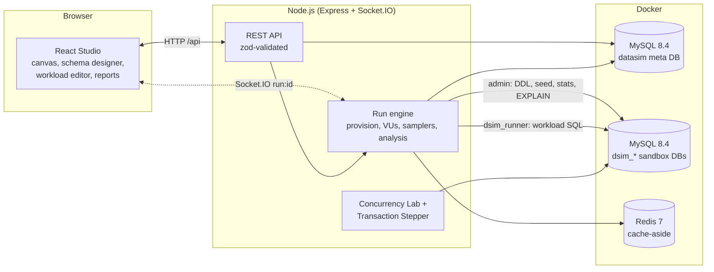
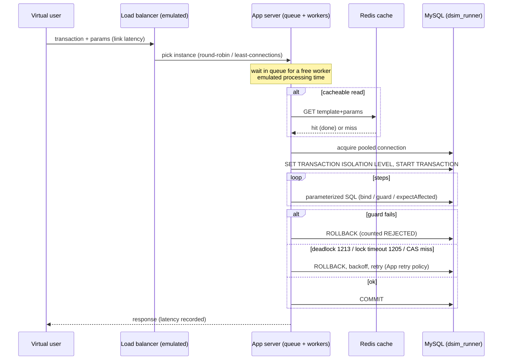

# DataSim v2: architecture

DataSim is a design-and-load-test studio for database engineers: drag components onto a canvas, design the schema, describe the workload, and run it against a **real MySQL 8.4 / InnoDB server**.

## Components

`shared/` (zod schemas and TS types: design document, schema model, workload, run report, socket events) is imported by both the server and the web app, so the browser and the server validate with the same code.

## Execution model

A **design** is a topology graph + schema model + workload model + run settings. A **run**:

1. **Validate** the design: topology rules (connection rules, one database, pool total <= 250), schema (keys, FKs, references), SQL static checks (statement verbs, no multi-statements, placeholders resolve), and MySQL itself by applying the DDL in a scratch schema.
2. **Provision the sandbox:** database `dsim_<projectShortId>` is dropped and created; the generated DDL is applied as admin; data is seeded deterministically from a seeded PRNG in batches of 1,000 rows, streaming progress.
3. **Warm up** (default 3 s), then measure.
4. **Virtual users** run closed-loop: pick a transaction by weight, generate parameters, send the request along the topology path:
   Users -> (link latency) -> [Load balancer] -> (link) -> App server (bounded in-flight workers with a queue, per-request processing time) -> (link) -> [Cache] -> Database (a real `mysql2` pool connection, a real transaction at the configured isolation level, real retries) -> response -> think time.
5. **Sample every second:** app-side latency percentiles, TPS, errors by class, retries, queue depths, pool usage; DB-side through an admin connection (`SHOW GLOBAL STATUS` deltas: `Threads_running`, `Innodb_row_lock_waits`, `Innodb_row_lock_time`, buffer-pool reads; and `performance_schema.data_lock_waits` snapshots for the wait-for graph). Deadlocks are counted from error 1213 per transaction.
6. **After the run:** execute the SQL invariants; read `events_statements_summary_by_digest` deltas for the sandbox schema; run `EXPLAIN FORMAT=JSON` for every statement template; compute findings, the bottleneck node and the SLO verdict; persist everything relationally; emit the report.

### Provenance of every number

| Tag | Meaning | Examples |
| --- | --- | --- |
| **MEASURED** | Observed from MySQL or the real request path | DB execution time, lock waits, deadlocks, rows examined, invariants, end-to-end wall-clock latency (which includes emulated delays and real queueing), cache hit ratio |
| **EMULATED** | An injected delay or modelled component that really runs in the request path | Link latency, app processing time, load balancer. They are real awaits, so they hold virtual users and create genuine queueing |
| **PROJECTED** | A model fitted to measured data | Capacity beyond the tested load (Universal Scalability Law fit), drawn dashed |

The cache is a real Redis (cache-aside on transactions marked cacheable; key = transaction + parameters; TTL configurable). If Redis is unreachable at run start, validation blocks the run; DataSim never silently emulates a cache.

### Phase timestamps ("where the time went")

Each request records `process.hrtime.bigint()` at: arrival, queue exit, link completion, app-processing completion, pool-connection acquired, and DB completion. The per-transaction stacked bar (queue / network / app / pool wait / DB execution) is computed from these, not estimated.

## One request

## Sandbox and SQL safety

* Workload SQL runs as `dsim_runner`, which has only `SELECT, INSERT, UPDATE, DELETE` on `dsim\_%`.*. It cannot run DDL and cannot read the `datasim` meta database.
* Statements must begin with `SELECT`, `INSERT`, `UPDATE`, `DELETE` or `WITH`. Multi-statement strings are rejected (the driver default is off). Values are always bound parameters.
* DDL is only generated by DataSim (`shared/src/ddl.ts`, identifiers validated against `^[a-z][a-z0-9_]{0,63}$` and always backtick-quoted) and executed by the admin connection.
* One run at a time (in-process flag plus MySQL `GET_LOCK('datasim_run')`); a second request is rejected with a clear message.

## Concurrency design

* The run engine is a single Node process. Virtual users are async loops, not threads; the bottleneck being measured is MySQL, not the load generator. App-server queues, worker limits and per-instance connection pools are explicit objects, so saturation (queue growth, pool starvation) appears where it would in a real deployment.
* Latencies are recorded into per-second buckets (no per-request sorting on the hot path); percentiles are computed once per second.
* Strategies are *variants of transaction steps* (naive, pessimistic, optimistic, atomic, serializable) selected on the App server node. The same workload, seed and topology can therefore be re-run under each strategy and compared.
* Run state is persisted relationally (see DATABASE_DESIGN.md) and pushed live over Socket.IO room `run:<id>`: `run:status`, `run:provision-progress`, `run:sample` (1 Hz), `run:locks` (at most 2 Hz), `run:finished`.

## Retained Review 1 components

The Concurrency Lab (`/lab`, `server/src/lab/*`, `server/src/strategies/*`) benchmarks all eight Review 1 strategies (NAIVE, TXN_RR, SERIALIZABLE, PESSIMISTIC, OPTIMISTIC, CONSTRAINT, TRIGGER, REDIS_LEASE) on the legacy tables; the Transaction Stepper (`/stepper`, `server/src/lab/stepper/*`) drives two real connections statement by statement and reads live locks from `performance_schema.data_locks` and `data_lock_waits`.
