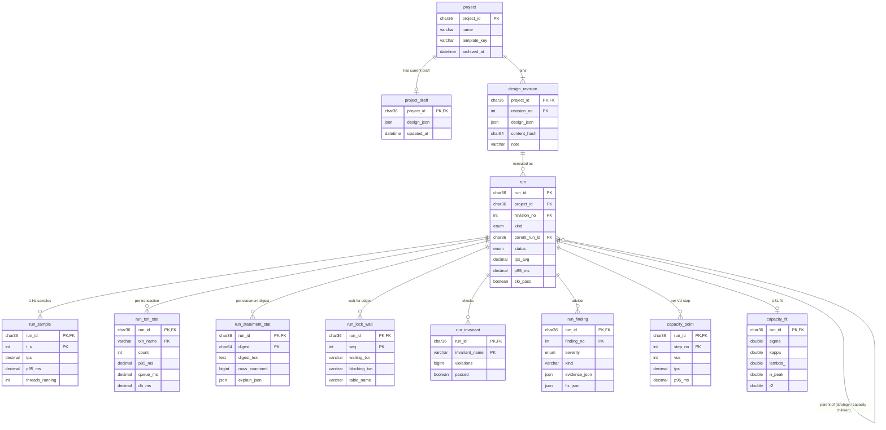
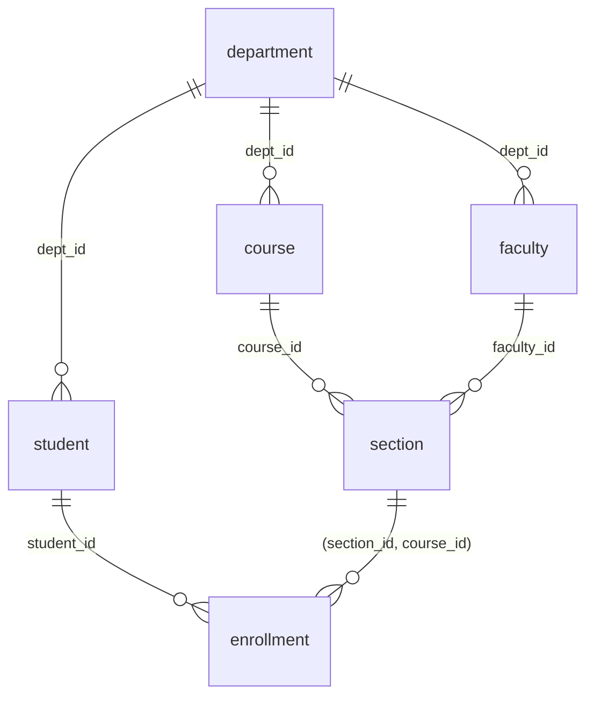
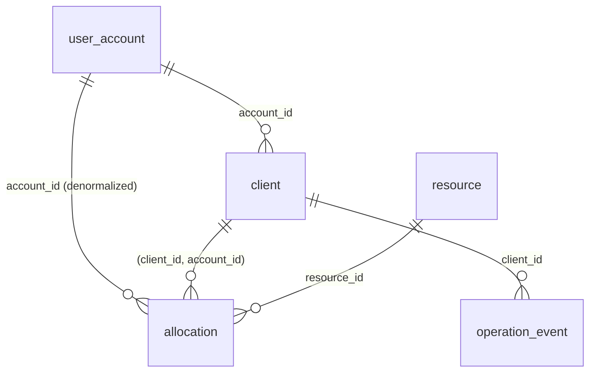

# DataSim v2: database design

DataSim stores its own state in the `datasim` database (MySQL 8.4, InnoDB, migration `db/migrations/005_datasim_v2.sql`). The sandbox databases (`dsim_<id>`) that runs execute against are separate and are generated from the user's schema model; they are described per template at the end.

## 1. Meta schema (ER diagram)

## 2. Keys, constraints and functional dependencies

Notation: `X -> Y` means X functionally determines Y. All tables are in BCNF unless noted.

| Table | Primary key | Other keys / constraints | Non-trivial functional dependencies |
| --- | --- | --- | --- |
| `project` | `project_id` | `ix_project_updated(archived_at, updated_at)` | `project_id -> name, description, template_key, created_at, updated_at, archived_at` |
| `project_draft` | `project_id` (FK to `project`, cascade) | | `project_id -> design_json, updated_at` |
| `design_revision` | `(project_id, revision_no)` | `UNIQUE(project_id, content_hash)`; FK to `project` | `(project_id, revision_no) -> design_json, content_hash, note, created_at`; `(project_id, content_hash) -> revision_no` (a second candidate key: identical designs are stored once) |
| `run` | `run_id` | FK `(project_id, revision_no)` to `design_revision`; FK `parent_run_id` to `run` (cascade) | `run_id -> every column`. `run_id` determines the revision, which determines the design; run settings are the tested configuration |
| `run_sample` | `(run_id, t_s)` | FK cascade | `(run_id, t_s) -> tps, p50_ms, ... , cache_hit_ratio` |
| `run_txn_stat` | `(run_id, txn_name)` | FK cascade | `(run_id, txn_name) -> count, committed, ..., db_ms` |
| `run_statement_stat` | `(run_id, digest)` | FK cascade | `(run_id, digest) -> digest_text, exec_count, avg_ms, rows_examined, explain_json`. (`digest -> digest_text` also holds globally; it is kept per run because the digest text is a snapshot of what the run actually executed, so this is a deliberate, controlled redundancy rather than an update anomaly: rows are written once and never updated) |
| `run_lock_wait` | `(run_id, seq)` | FK cascade | `(run_id, seq) -> at_ms, waiting_txn, blocking_txn, table_name, index_name, lock_mode, lock_data` |
| `run_invariant` | `(run_id, invariant_name)` | FK cascade | `(run_id, invariant_name) -> sql_text, violations, passed` (`passed` is derived from `violations = 0` but stored as the verdict of that run) |
| `run_finding` | `(run_id, finding_no)` | FK cascade | `(run_id, finding_no) -> severity, kind, title, explanation, evidence_json, fix_json` |
| `capacity_point` | `(run_id, step_no)` | FK cascade | `(run_id, step_no) -> vus, tps, p50_ms, p95_ms, error_rate` |
| `capacity_fit` | `run_id` | FK cascade | `run_id -> sigma, kappa, lambda_, n_peak, x_max, r2, knee_vus, sustained_vus, sentence` |

## 3. Normalization argument

* **1NF.** Every column holds one atomic value (a number, a short string, an enum). The only non-scalar columns are the JSON documents discussed in section 4, which are treated as opaque values by the database.
* **2NF.** Tables with composite keys (`design_revision`, `run_*`, `capacity_*`) have no attribute that depends on only part of the key. Every non-key attribute of `run_sample`, `run_txn_stat`, `run_lock_wait`, `run_invariant`, `run_finding` and `capacity_point` describes one specific `(run, row-within-run)` pair. `design_revision.note` and `content_hash` describe the revision, not the project alone.
* **3NF / BCNF.** In every table the left side of every non-trivial functional dependency is a superkey. The only second candidate key is `(project_id, content_hash)` in `design_revision`, and the dependency `(project_id, content_hash) -> revision_no` has a superkey on its left. There are no transitive dependencies between non-key attributes: for example `run` stores `strategy`, `isolation_level`, `vus`, `duration_s` and `seed` because they record the settings *as run* (overrides can differ from the revision), not as a function of the revision.
* **Controlled redundancy, stated honestly.** `run.strategy / isolation_level / vus / duration_s` partly repeat information that also exists inside the revision's JSON (and can be overridden at run time). They are copied so that the Runs table can be filtered and compared with plain SQL. Aggregates on `run` (`txn_total`, `committed`, `tps_avg`, `p50_ms`...) are derivable from `run_txn_stat` and `run_sample`; they are stored once at the end of the run so that the Runs list does not aggregate thousands of rows per request. They are written exactly once, inside the same logical step that writes the child rows, and never updated afterwards.

## 4. Why JSON for the editor document, and only there

`design_revision.design_json` and `project_draft.design_json` hold the *design document*: topology graph, schema model, workload model, SLO and capacity settings. The document is versioned (`schemaVersion`), validated by one zod schema shared by the browser and the server, and always read and written whole by the editor. Nothing in the product queries *inside* it with SQL, so there is nothing to normalize and no join the document would make cheaper. Modelling the graph, tables, columns and SQL steps relationally would add roughly a dozen tables and a join-heavy load/save path with no analytical benefit. Everything that is queried, filtered or compared (runs, samples, statistics, findings, invariants, locks, capacity points) is relational. `evidence_json`, `fix_json` and `explain_json` hold per-row evidence blobs that are only ever displayed.

Immutability: a revision is never updated. Autosave only writes `project_draft`; Save or Run pins a new `design_revision` (or reuses one with the same content hash). Runs reference a revision by composite foreign key, so a report can always show the exact design that produced it, and Compare can show a design diff between any two revisions.

## 5. Indexes and the queries they serve

| Index | Serves |
| --- | --- |
| `project(archived_at, updated_at)` | Projects page: non-archived projects, most recently updated first |
| `design_revision(project_id, content_hash)` unique | `pinCurrent`: "is this exact design already a revision?" (idempotent pin) |
| `run(project_id, created_at)` | Runs page filtered by project, newest first; "last run" column on Projects |
| `run(parent_run_id)` | Loading the children of a strategy-comparison or capacity parent |
| Primary keys of `run_*` tables `(run_id, ...)` | Loading a full report: every child table is read with `WHERE run_id = ?` as a prefix range scan; ordered by the second key column (time, step, sequence) for free |

## 6. Sandbox databases and template schemas

Each run provisions `dsim_<first 8 hex of project id>`: dropped and re-created, real `CREATE TABLE` DDL (PK, FK, UNIQUE, INDEX, CHECK, STORED generated columns) generated deterministically by `shared/src/ddl.ts`, then seeded with batched multi-row inserts from a seeded PRNG. Workload SQL runs as the restricted `dsim_runner` user (`SELECT, INSERT, UPDATE, DELETE` on `dsim\_%`.* only).

### T1: Course Registration Rush

Normalization notes: every table is BCNF (`reg_no` and `code` are alternate keys, each determines its row). `enrollment(student_id, section_id, course_id)` carries `course_id` redundantly: `section_id -> course_id` already holds. This is **controlled redundancy** (Review 1 section 8.5): the composite FK `(section_id, course_id) -> section(section_id, course_id)` (target `UNIQUE(section_id, course_id)`) makes MySQL guarantee the copy is consistent, and it lets `UNIQUE(student_id, course_id)` enforce "a student takes a course at most once" as a plain constraint instead of application code. `section.enrolled` is a deliberate derived counter (`enrolled = COUNT(enrollment rows)`): it makes seat checks O(1), and the `counter_consistent` invariant exists precisely to detect when concurrency breaks that derivation. `section.slot` has no index on purpose, so the advisor can find the full scan.

### T2: Review 1 shared-resource allocation

Normalization notes: this is exactly the Review 1 schema. `allocation.account_id` is a deliberate denormalization (`client_id -> account_id`), kept consistent by the composite FK `(client_id, account_id) -> client(client_id, account_id)`. The STORED generated column `active_account_id = IF(status = 'ACTIVE', account_id, NULL)` makes "one active allocation per account" expressible as `UNIQUE(active_account_id)` (NULLs do not collide), which is the CONSTRAINT strategy: a concurrency-control strategy that lives in the schema, not in application code. `UNIQUE(client_id, client_request_id)` on `operation_event` provides idempotency for retried requests.

### T3 and T4

T3 (flash sale: `product`, `customer`, `orders`, `order_item(PK(order_id, product_id))`) and T4 (bank: `account`, `transfer`, `bank_meta`) follow the same conventions. `order_item` is BCNF with the composite key; `price` is copied into `order_item` as the price *at purchase time* (a historical fact, not a redundancy). `bank_meta(k, v)` stores the conserved total used by the `total_conserved` invariant.
